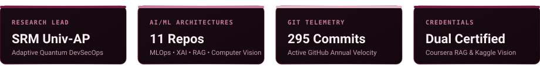
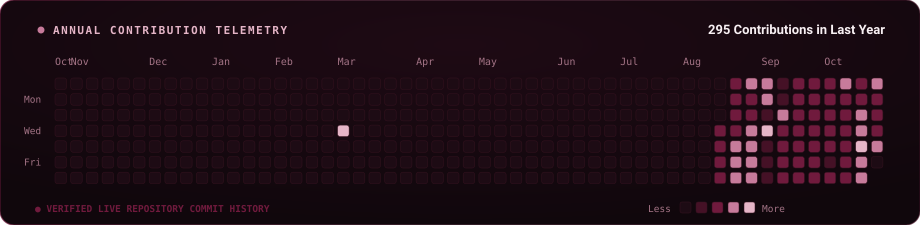
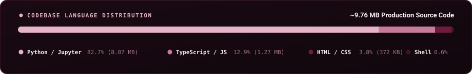

  

  

---

### ✦ Professional Profile &amp; Mission

I am an **AI/ML Engineer and Software Developer** currently pursuing my **B.Tech in Computer Science and Engineering (Artificial Intelligence and Machine Learning)** at **D. Y. Patil International University (DYPIU)**, Pune (2023 – 2027).

My technical journey centers on transforming statistical models and machine learning algorithms into resilient, production-ready systems. Through both applied academic research and software engineering internships, I specialize in:

- **Applied Machine Learning & Predictive Modeling**: Engineering classification, regression, and ranking platforms with ensemble methods (XGBoost, Random Forest), deep learning pipelines, and Game-Theoretic Explainable AI (SHAP).
- **Quantum-Aware DevSecOps & Cloud Telemetry**: Leading research into automated behavioral anomaly detection, microservices-based telemetry ingestion (Prometheus / Node Exporter), and real-time Adaptive Unified Risk Scoring (URS).
- **Production APIs & Microservices**: Building high-throughput, low-latency REST and WebSocket services using FastAPI, Flask, and Docker containerization.
- **Modern Full-Stack Interfaces**: Designing high-performance dashboards and interactive web applications utilizing React.js, Next.js, and Streamlit.
- **End-to-End MLOps**: Implementing continuous integration, model registries with MLflow, data version control with DVC, and automated testing suites.

---

### 🏛️ Verified Research &amp; Industry Experience

<table>
  <thead>
    <tr style="border-bottom: 2px solid #701A3D;">
      <th align="left">Organization &amp; Mentorship</th>
      <th align="left">Role &amp; Focus Area</th>
      <th align="center">Duration</th>
      <th align="left">Key Contributions &amp; Architectural Impact</th>
    </tr>
  </thead>
  <tbody>
    <tr>
      <td>
        <b>SRM University-AP</b> 
        <i>Dept. of Computer Science &amp; Engineering</i> 
        Mentored by Dr. Varsha Sambhaje
      </td>
      <td>
        <b>AI / ML Research Intern Lead</b> 
        <code>Cloud Security &amp; DevSecOps</code>
      </td>
      <td align="center">
        <code>May 2026 – Jul 2026</code>
      </td>
      <td>
        • Architected a modular microservices pipeline for an <b>Adaptive AI-Driven Quantum-Aware DevSecOps Framework</b>. 
        • Ingested real-time host and network telemetry via <b>Prometheus &amp; Node Exporter</b> into MongoDB. 
        • Trained ML models for behavioral anomaly detection and dynamic <b>Unified Risk Score (URS)</b> forecasting. 
        • Built an automated policy mitigation simulator and a centralized <b>React.js</b> real-time visualization dashboard.
      </td>
    </tr>
    <tr>
      <td>
        <b>Radhakrishna Web Solution</b> 
        <i>Software Engineering</i>
      </td>
      <td>
        <b>Full Stack Developer Intern</b> 
        <code>Backend &amp; Algorithm Design</code>
      </td>
      <td align="center">
        <code>May 2025 – Jul 2025</code>
      </td>
      <td>
        • Designed and optimized high-performance backend modules in <b>C++ and Python</b>. 
        • Implemented optimized data structures and algorithms, reducing compute overhead and latency. 
        • Collaborated across cross-functional engineering teams to harden application reliability and deployment speed.
      </td>
    </tr>
  </tbody>
</table>

#### 📜 Verified Certifications &amp; Credentials
- 🎓 **Retrieval-Augmented Generation (RAG) with Embeddings &amp; Vector Databases** — Scrimba &amp; Coursera  
  *Credential ID: [`Y5OMV0KUR4Y3`](https://coursera.org/verify/Y5OMV0KUR4Y3)*
- 👁️ **Computer Vision** — Kaggle Certification of Completion  
  *Authorized by Ryan Holbrook &amp; Alexis Cook (Issued Nov 16, 2025)*

---

### 🚀 Selected Real-World Engineering Projects

<table>
  <thead>
    <tr style="border-bottom: 2px solid #701A3D;">
      <th width="32%" align="left">Project &amp; Repository</th>
      <th width="48%" align="left">Architecture &amp; Problem Solved</th>
      <th width="20%" align="left">Core Stack</th>
    </tr>
  </thead>
  <tbody>
    <tr>
      <td>
        <b><a href="https://github.com/shivrajpawar514-commits/Adaptive-AI-driven-Quantum-Aware-devsecops-Framework">Adaptive AI DevSecOps Framework</a></b> 
        Research Pipeline &amp; Anomaly Engine
      </td>
      <td>
        Addresses critical gaps in traditional cloud security—such as delayed incident triage and static risk models—by combining continuous Prometheus telemetry ingestion, ML behavioral anomaly classifiers, automated attack simulation, and adaptive risk trend mitigation.
      </td>
      <td>
        <code>Python</code> 
        <code>DevSecOps</code> 
        <code>Prometheus</code> 
        <code>MongoDB</code> 
        <code>React.js</code>
      </td>
    </tr>
    <tr>
      <td>
        <b><a href="https://github.com/shivrajpawar514-commits/winning-predictor">Winning Predictor</a></b> 
        IPL Real-Time Match Analytics Platform
      </td>
      <td>
        Enterprise-grade ML system estimating live 2nd innings win probabilities and 1st innings score targets. Features Explainable AI (SHAP) feature attribution, What-If scenario simulations, a production FastAPI REST backend, and an interactive Streamlit UI.
      </td>
      <td>
        <code>Python</code> 
        <code>Random Forest</code> 
        <code>XGBoost</code> 
        <code>FastAPI</code> 
        <code>Docker</code>
      </td>
    </tr>
    <tr>
      <td>
        <b><a href="https://github.com/shivrajpawar514-commits/Rag-Chatbot">Rag-Chatbot</a></b> 
        Academic Knowledge Retrieval &amp; Q&amp;A Engine
      </td>
      <td>
        Production-grade Retrieval-Augmented Generation (RAG) dashboard answering queries over unstructured academic and research documents using hybrid semantic + keyword search, ChromaDB vector indexing, and Sentence-Transformers embeddings.
      </td>
      <td>
        <code>Google Gemini</code> 
        <code>LangChain</code> 
        <code>ChromaDB</code> 
        <code>FastAPI</code> 
        <code>Docker</code>
      </td>
    </tr>
    <tr>
      <td>
        <b><a href="https://github.com/shivrajpawar514-commits/Telecom-customer-churn-Pipeline">Telecom Churn MLOps Pipeline</a></b> 
        End-to-End MLOps &amp; Automated Pipeline
      </td>
      <td>
        Continuous lifecycle MLOps system featuring version-controlled data pipelines (DVC), model registry (MLflow), automated drift monitoring, real-time prediction REST endpoints, and containerized deployment via GitHub Actions CI/CD.
      </td>
      <td>
        <code>MLOps</code> 
        <code>MLflow</code> 
        <code>DVC</code> 
        <code>FastAPI</code> 
        <code>Docker</code>
      </td>
    </tr>
    <tr>
      <td>
        <b><a href="https://github.com/shivrajpawar514-commits/CollabAI">CollabAI</a></b> 
        Autonomous Workspace &amp; AI Lab
      </td>
      <td>
        Next-generation collaborative platform featuring real-time WebSockets, multi-provider LLM fallback matrix (Gemini / Groq / Ollama), Prometheus latency telemetry, and autonomous agent orchestration.
      </td>
      <td>
        <code>Next.js 14</code> 
        <code>FastAPI</code> 
        <code>WebSockets</code> 
        <code>Prometheus</code> 
        <code>Docker</code>
      </td>
    </tr>
    <tr>
      <td>
        <b><a href="https://github.com/shivrajpawar514-commits/Flight-prediction-system">AeroPulse AI</a></b> 
        Flight Price Prediction &amp; Market Intelligence
      </td>
      <td>
        Multi-model stacking ensemble integrating Game-Theoretic SHAP interpretability, TOPSIS multi-criteria decision making, 2D Pareto Optimal Trade-Off frontier, and real-time sensitivity simulations within a cyber-aviation glassmorphism UI.
      </td>
      <td>
        <code>Scikit-learn</code> 
        <code>Stacking Models</code> 
        <code>Flask</code> 
        <code>SHAP (XAI)</code> 
        <code>Matplotlib</code>
      </td>
    </tr>
    <tr>
      <td>
        <b><a href="https://github.com/shivrajpawar514-commits/resume-scorer-app">Resume Scorer &amp; ATS Analytics</a></b> 
        Diagnostic NLP &amp; Quantifiable Scorer
      </td>
      <td>
        Advanced NLP parser using spaCy, TF-IDF semantic embeddings, Google X-Y-Z formula diagnostics, and interactive 5D radar visualizations to provide quantifiable feedback on resume-job alignment.
      </td>
      <td>
        <code>Python</code> 
        <code>NLP (spaCy)</code> 
        <code>TF-IDF</code> 
        <code>FastAPI</code> 
        <code>Streamlit</code>
      </td>
    </tr>
    <tr>
      <td>
        <b><a href="https://github.com/shivrajpawar514-commits/Cineflix---Movie-ticket-booking-and-management-system">CineFlix Management System</a></b> 
        Ticket Booking &amp; SLA Case Visualizer
      </td>
      <td>
        Dual-portal booking system supporting Customer reservations and Agent administration. Includes seat allocation algorithms, case lifecycle tracking, and interactive SLA simulation for urgency escalations.
      </td>
      <td>
        <code>React.js</code> 
        <code>JavaScript</code> 
        <code>State Flow</code> 
        <code>SLA Visualizer</code> 
        <code>Git</code>
      </td>
    </tr>
  </tbody>
</table>

---

### ⚡ Verified Technical Skills &amp; Stack

<table>
  <tr>
    <td width="22%" style="background-color: #190B12;"><b>Languages</b></td>
    <td>
      
      
      
      
      
      
    </td>
  </tr>
  <tr>
    <td width="22%" style="background-color: #190B12;"><b>Machine Learning &amp; AI</b></td>
    <td>
      
      
      
      
      
      
      
      
      
    </td>
  </tr>
  <tr>
    <td width="22%" style="background-color: #190B12;"><b>Backend &amp; MLOps</b></td>
    <td>
      
      
      
      
      
      
      
    </td>
  </tr>
  <tr>
    <td width="22%" style="background-color: #190B12;"><b>Frontend &amp; UI</b></td>
    <td>
      
      
      
      
      
      
    </td>
  </tr>
  <tr>
    <td width="22%" style="background-color: #190B12;"><b>Data &amp; Vector Stores</b></td>
    <td>
      
      
      
      
    </td>
  </tr>
</table>

---

### 📊 Genuine GitHub Contribution Telemetry

  

---

### 📈 Codebase &amp; Language Architecture

  

---

### 🌐 Verified Professional &amp; Academic Profiles

  
  &nbsp;
  
  &nbsp;
  

 

  🎓 <b>D. Y. Patil International University</b>, Akurdi, Pune • B.Tech CSE (AI &amp; ML) 2023–2027 
  📍 Pune, Maharashtra, India • Open for AI/ML Engineering &amp; Research Opportunities

 

---

  

